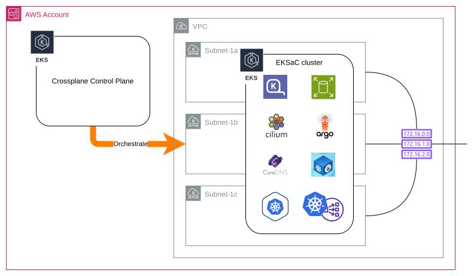

# EKS as Comsumables

## Introduction
EKS as Consumables (EKSaC) is designed to address various challenges that the Platform team is facing with EKS infrastructure in the organisation.

## Preliminaries
EKSaC is built with different tools to achieve the capabilities.  To understand EKSaC, it is necessry to understand the concept of some of the tools used.

### Crossplane
**Crossplane** is a Kubernetes native control plane framework for platform engineering.  There are some concepts in **Crossplane** that is core to EKSaC:
- **Crossplane** is extensible by allowing the creation of Kubernetes custom resources without having to write the controller
- There are a few components in **Crossplane** which are good to understand:
  -  _ManagedResources_ (_MR_) are external services / resources in a _Provider_.  An example would be a _subnet_ resource in AWS.  An example of an _MR_
      <details>
      <summary>MR example</summary>

      ```yaml
      apiVersion: ec2.aws.upbound.io/v1beta1
      kind: Subnet
      metadata:
        name: linus-cluster-xplane-private-subnet-1a
      spec:
        deletionPolicy: Delete
        forProvider:
          availabilityZone: ap-southeast-1a
          cidrBlock: 10.0.0.128/25
          privateDnsHostnameTypeOnLaunch: ip-name
          region: ap-southeast-1
          vpcId: vpc-0c402772c8d100967
          vpcIdRef:
            name: linus-network-xplane-vpc
      ```
      </details>
  - _Compositions_ are templates to define how to create resources.  For example, to create a _vpc_ with 3 _subnets_, instead of creating 3 _MRs_, a _Composition_ can be created which includes these 4 _MRs_ (_vpc_ and 3 _subnets_).  The example of such _Composition_ would look like
    <details>
    <summary>Composition example</summary>

    ```yaml
    apiVersion: apiextensions.crossplane.io/v1
    kind: Composition
    metadata:
      name: x-network-kcl
    spec:
      compositeTypeRef:
        apiVersion: consumable.minisrc.com/v1alpha1
        kind: xNetworkKcl
      mode: Pipeline
      pipeline:
      - step: create-vpc
        functionRef:
          name: function-kcl
        input:
          apiVersion: krm.kcl.dev/v1alpha1
          kind: KCLInput
          metadata:
            name: "xplane-vpc"
          spec:
            target: Default
            source: |
              oxr = option("params").oxr

              items = [{
                apiVersion = "ec2.aws.upbound.io/v1beta1"
                kind = "VPC"
                metadata.name = oxr.spec.name + "-xplane-vpc"
                spec.forProvider = {
                  region = oxr.spec.location
                  cidrBlock = oxr.spec.vpcCidr
                  enableDnsSupport = True
                  enableDnsHostnames = True
                }
              }]
      - step: create-public-subnets
        functionRef:
          name: function-kcl
        input:
          apiVersion: krm.kcl.dev/v1alpha1
          kind: KCLInput
          metadata:
            name: "xplane-subnets"
          spec:
            target: Default
            source: |
              oxr = option("params").oxr
              public_subnets = oxr.spec.subnets.public

              items = [{
                apiVersion = "ec2.aws.upbound.io/v1beta1"
                kind = "Subnet"
                metadata.name = oxr.spec.name + "-xplane-public-subnet-" + zone
                spec.forProvider = {
                  region = oxr.spec.location
                  availabilityZone = "ap-southeast-" + zone
                  cidrBlock = cidr
                  vpcIdRef.name = oxr.spec.name + "-xplane-vpc"
                }
              } for zone, cidr in public_subnets]
      - step: auto-ready
        functionRef:
          name: function-auto-ready
    ```
    </details>
  - _CompositionResourceDefinitions_ (_XRD_) are the custom API definitions for _CompositionResources_ (_XRs_).  The example _XRD_ for a _vpc_ and 3 _subnets_ would look like
    <details>
    <summary>XRD example</summary>

    ```yaml
    apiVersion: apiextensions.crossplane.io/v1
    kind: CompositeResourceDefinition
    metadata:
      name: xnetworkskcl.consumable.minisrc.com
    spec:
      group: consumable.minisrc.com
      names:
        kind: xNetworkKcl
        plural: xnetworkskcl
      versions:
      - name: v1alpha1
        schema:
          openAPIV3Schema:
            type: object
            properties:
              spec:
                type: object
                properties:
                  name:
                    type: string
                  location:
                    type: string
                    oneOf:
                    - pattern: '^ap-southeast-1$'
                  vpcCidr:
                    type: string
                  subnets:
                    type: object
                    properties:
                      public:
                        type: object
                        properties:
                          1a:
                            type: string
                          1b:
                            type: string
                          1c:
                            type: string
                required:
                - name
      claimNames:
        kind: NetworkKcl
        plural: networkskcl
    ```
    </details>
  - _CompositionResources_ are created by the custom API defined in _XRD_ using the _Composition_ template to create _MRs_.  An example of _XR_ manifest would look like
    <details>
    <summary>XR manifest example</summary>

    ```yaml
    apiVersion: consumable.minisrc.com/v1alpha1
    kind: NetworkKcl
    metadata:
      name: linus-network
      namespace: eksac
    spec:
      name: linus-network
      location: "ap-southeast-1"
      vpcCidr: "10.0.0.0/22"
      subnets:
        public:
          1a: "10.0.0.0/28"
          1b: "10.0.0.16/28"
          1c: "10.0.0.32/28"
    ```
    </details>
  - _Claims_ (_XRC_) are namespace scopped "_XR_"

> [!TIP]
> - _XRC_ will look like the _XR_ manifest but _XR_ will have _MR_ references
> - Throughout the documents, _XRC_ and _XR_ might get a bit mixed up
> - To delete a created _XR_, delete the _XRC_, otherwise the _XRC_ will re-create the _XR_

## EKSaC Concepts


1.  A **Crossplane** control plane is responsible to orchestration the resources

1.  The pre-requisite is that _vpc_, _route_table_ and egress network exists
    - Any "non-local" traffic should be able to route to the Internet through _transit gateway_

1.  EKSaC core components are the minimal components needed to bring up an EKS cluster.  The components includes:
    - Private _subnets_ where the EKS nodes resides
    - EKS cluster configured properly with
      - _Security groups_
      - _IAM policies_ and _IAM roles_
      - Access entries
      - OIDC
    - Karpenter
      - _IAM policies_ and _IAM roles_
      - _Fargate_ profile for Karpenter
      - Default _EC2 NodeClass_
      - Infra `arm64` and `amd64` _NodePools_ with
        - _Taint_
        - _expireAfter_ (2 hours)
      - _Cronjob_ that restart Karpenter hourly
    - Cilium CNI with
      - _Kube proxy_ replacement
      - **Ensure `socketLB.hostNamespaceOnly=true` for Cilium CNI to work with Istio CNI in ambient mesh
    - CoreDNS
      - **Ensure `service.clusterIP` is set properly
    - **Argo CD**
      - To be used for additional component orchestration
    - Metrics Server
    - AWS Load Balancer Controller
    - Addons
      - Amazon EBS CSI Driver
      - Amazon EKS Pod Identity Agent
      - **These can be consider to deploy via _helm_ in the future

1.  The _XR_ manifest should look like
    <details>
    <summary>xEksClusterKcl manifest</summary>

    ```yaml
    apiVersion: consumable.minisrc.com/v1alpha1
    kind: EksClusterKcl
    metadata:
      name: linus-cluster
      namespace: eksac
    spec:
      name: linus-cluster
      location: "ap-southeast-1"
      awsAccountId: "390945758345"
      vpcRef: linus-network
      subnets:
        private:
          1a: "10.0.0.128/25"
          1b: "10.0.1.0/25"
          1c: "10.0.1.128/25"
      components:
        argocdHelm:
          version: "8.0.6"
        ciliumHelm:
          version: "1.17.4"
        corednsHelm:
          version: "1.42.1"
        ebscsiAddOn:
          version: "v1.43.0-eksbuild.1"
        karpenterHelm:
          version: "1.4.0"
        podidentityagentAddOn:
          version: "v1.3.7-eksbuild.2"
    ```
    </details>

The idea is that once the EKSaC cluster is up, the other components would be deployed using **Argo CD** within the cluster.
- "Platform" components can leverage the "infra" _NodePools_ keeping in mind of the `taint` as well as the `expiredAfter`
- Other components can "choose" to create their own _NodePools_

## TODO
1.  Design / architecting the **Crossplane** control plane deployment
1.  **Crossplane** cross AWS account deployment of EKSaC clusters
1.  **Argo CD**
    1.  Integration to Okta SCIM/SAML2.0
1.  Design / architecting the rolling of the **Crossplane** control plane
1.  Explore [Renovate](https://docs.renovatebot.com/) to automatically update component versions