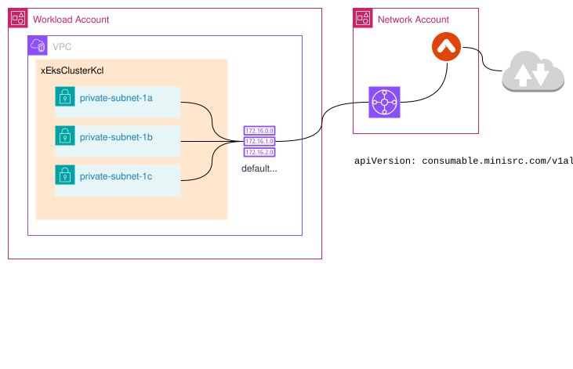

# EKSaC Cluster Network Components

## Introduction
In EKSaC, the EksClusterKcl _XRC_ will only create the private _subnets_ and assume that the _vpc_ has already configured with appropriate routing.  The CIDR for each _subnet_ would have to be provided.  `vpcRef` in the _XR_ is currently using _vpc_ name, this might have to be changed to _vpc_ id instead.

## Prerequisites / Assumptions

- Egress network is setup
- _Vpc_ is created
- Routing is setup on the _vpc_ that any "non-local" traffic would be routed correctly
- CIDRs are crafted out for the _subnets_ taking into consideration of blue/green cluster deployment requirement

## _XR_ and _Composition_
- The _XR_ section of _xEksClusterKcl_ with respect to the network component is as follows
  <details>
  <summary>XR</summary>

  ```yaml
  apiVersion: consumable.trustbank.sg/v1alpha1
  kind: EksClusterKcl
  metadata:
    name: linus-cluster
    namespace: eksac
  spec:
    name: linus-cluster
    location: "ap-southeast-1"
    awsAccountId: "390945758345"
    vpcRef: linus-network
    subnets:
      private:
        1a: "10.0.0.128/25"
        1b: "10.0.1.0/25"
        1c: "10.0.1.128/25"
    components:
      # Removed for brevity
  ```
  </details>

  <details>
  <summary>Composition</summary>

  ```yaml
  # Removed for brevity
    - step: create-private-subnets
      functionRef:
        name: function-kcl
      input:
        apiVersion: krm.kcl.dev/v1alpha1
        kind: KCLInput
        metadata:
          name: "xplane-subnets"
        spec:
          target: Default
          source: |
            oxr = option("params").oxr
            private_subnets = oxr.spec.subnets.private

            items = [{
              apiVersion = "ec2.aws.upbound.io/v1beta1"
              kind = "Subnet"
              metadata.name = oxr.spec.name + "-xplane-private-subnet-" + zone
              spec.forProvider = {
                region = oxr.spec.location
                availabilityZone = "ap-southeast-" + zone
                cidrBlock = cidr
                tags: {
                  Name = oxr.spec.name + "-xplane-private-subnet-" + zone
                  Owner = "linus.yong"
                  Environment = "sandbox"
                  Project = "crossplane"
                }
                vpcIdRef.name = oxr.spec.vpcRef + "-xplane-vpc"
              }
              spec.providerConfigRef.name = "provider-aws-ec2"
            } for zone, cidr in private_subnets]
  # Removed for brevity
  ```
  </details>

## TODO
1.  _Tags_ to be updated from _XR_ instead of hard-coded
1.  Check if the `vpcRef` should use _vpc_ id instead of _vpc_ name
1.  Design segregation of _XRs_ _namespaces_
1. POC of using AWS IPAM and use AWS IPAM for CIDRs assignment for EKSaC _subnets_
